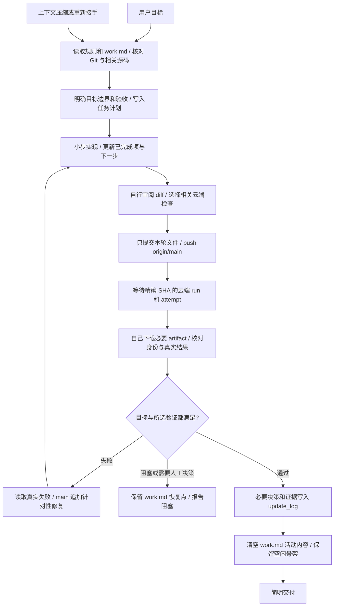
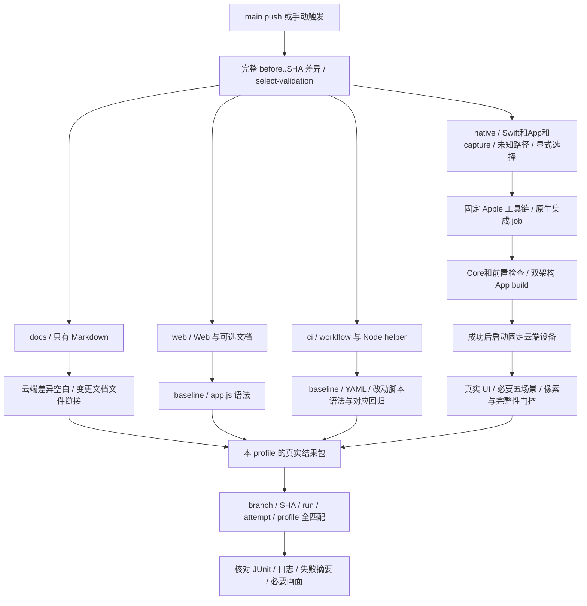
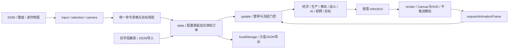
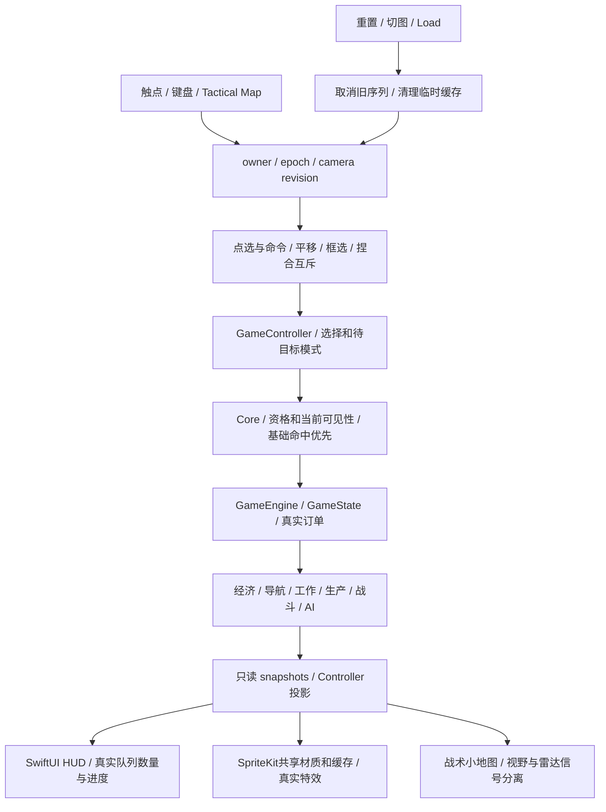
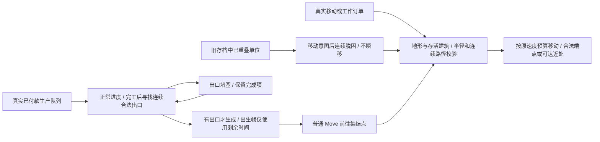

# 当前流程图

配套 [核心流程](flow.md)、[测试规范](../test/test.md) 与 [任务记忆](../../work.md)。本页只画当前真实流程；历史版本图保存在 [flowchart-history.md](flowchart-history.md)，不再作为当前开发制度。

## 自主迭代与恢复

## 云端按影响范围分流

纯文档不触发 Swift/Xcode/模拟器/UI/截图；CI 变更若影响原生执行链路，需显式 native 的真实证据。轻量 profile 通过不等于游戏或原生版本验收通过。默认禁止任何本机测试。

## Web 状态与每帧执行

## 原生输入与表现

## 导航与生产出口

